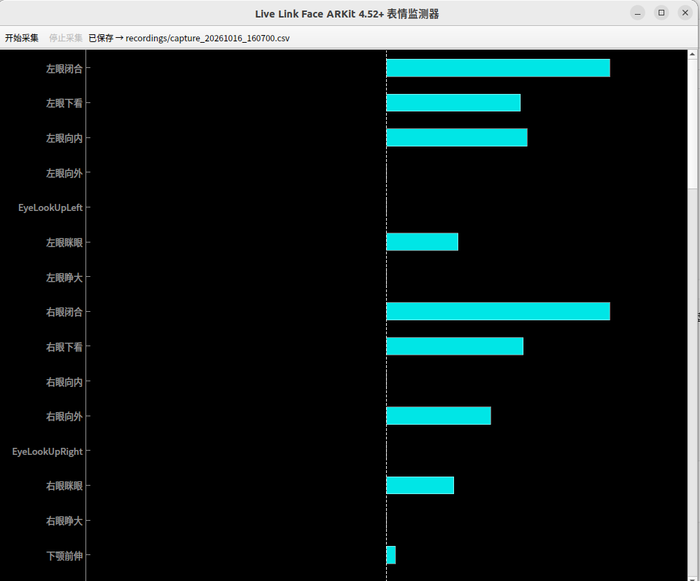

# LiveLinkFace-Visualizer 🚀

一个轻量级的、高性能的 Live Link Face 数据实时可视化工具。


## 📖 项目简介

**LiveFaceViz** (LiveLinkFace-Visualizer) 是专门为数字人开发者、动画师设计的面部捕捉调试工具。它可以实时接收来自 iPhone 端 **Live Link Face** App 的 UDP 数据流，并将 52 组 ARKit Blendshapes 转化为直观的、带中文标注的动态柱状图，帮助你精准观测每一块面部肌肉的数值变动。


## ✨ 核心特性

- **高性能渲染**：基于 `pyqtgraph` 实现，超低 CPU 占用，支持丝滑的实时帧率刷新。
- **中文支持**：内置完整的 ARKit Blendshape 翻译，不再需要对着英文文档查阅 JawOpen 或 CheekPuff 的含义。
- **高分屏适配**：支持 4K 及高缩放倍率屏幕，界面清晰不模糊。
- **零环境依赖（UE）**：无需打开庞大的 Unreal Engine，即可独立完成面部动捕的数据校准与演员测试。
- **双向监测**：支持对头转（Pitch/Yaw/Roll）等具有正负值属性的数据进行双向图表展示。


## 🛠️ 技术栈

- **GUI 框架**: PyQt5
- **绘图引擎**: pyqtgraph
- **数据协议**: UDP / PyLiveLinkFace (ARKit 4.52+)
- **数值计算**: NumPy


## 📦 环境依赖 (Dependencies)

本项目基于 Python 开发，核心运行环境要求如下：

| 依赖库             | 版本      | 说明                        |
| :----------------- | :-------- | :-------------------------- |
| **PyQt5**          | `5.15.11` | UI 界面基础框架             |
| **pyqtgraph**      | `0.14.0`  | 高性能实时科学绘图库        |
| **NumPy**          | `2.2.6`   | 矩阵数值计算                |
| **PyLiveLinkFace** | `0.1`     | Live Link Face 协议解码核心 |
| **timecode**       | `1.5.1`   | 帧率与时间码同步处理        |
| **colorama**       | `0.4.6`   | 终端输出着色辅助            |


## ⚙ 配置 App

1. 在 iPhone 上打开 **Live Link Face** App；
2. 进入设置，**捕捉** 功能内的 **模式** ，选择 **ARKit** ；
3. **流送** 功能内的 **Live Link** 内，**协议** 选择 **4.25及以后版本** ；**目标** 地址填写你电脑的 **IP地址** ；
4. 确保端口号默认为 `11111`（或在代码中修改 `UDP_PORT`）。


## 🚀 快速安装 (Quick Start)

你可以通过项目根目录下的 `requirements.txt` 或直接执行以下命令安装所有匹配版本：

**1.安装依赖**

```bash
pip install -r requirements.txt
```

**2.运行程序**

```bash
python main.py
```

**小贴士**：由于你使用的是 **NumPy 2.2.6**，如果用户在运行过程中遇到某些依赖库不兼容（旧库可能不支持 NumPy 2.0+ 协议），你可能需要建议他们升级对应的库或将 NumPy 降级至 `1.26.4`。

## 📸 界面预览



## ⚖️ 开源协议

本项目采用 MIT License 协议。

